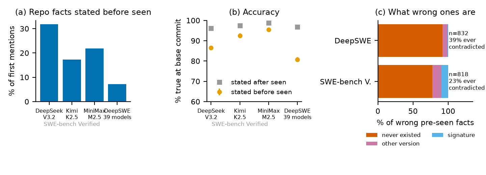
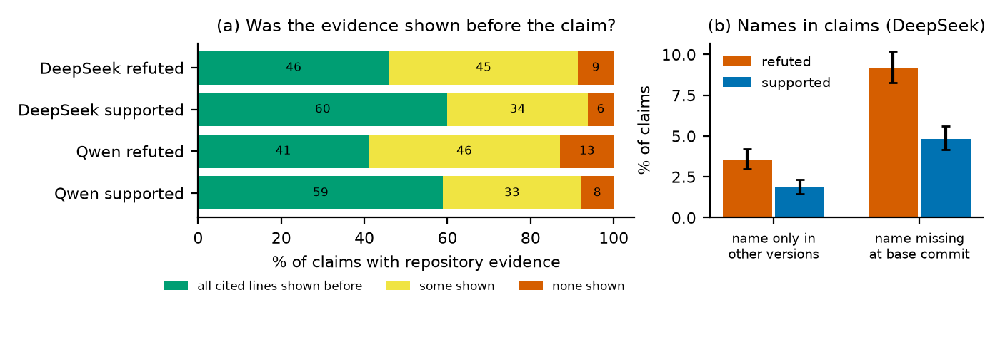
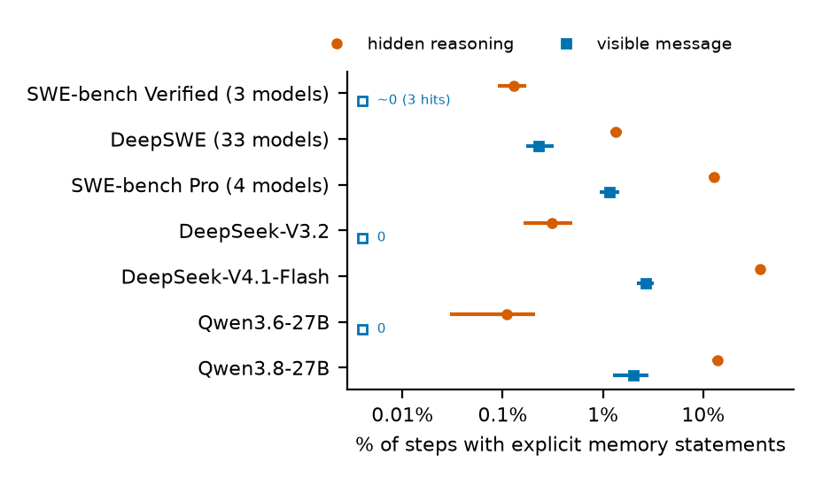
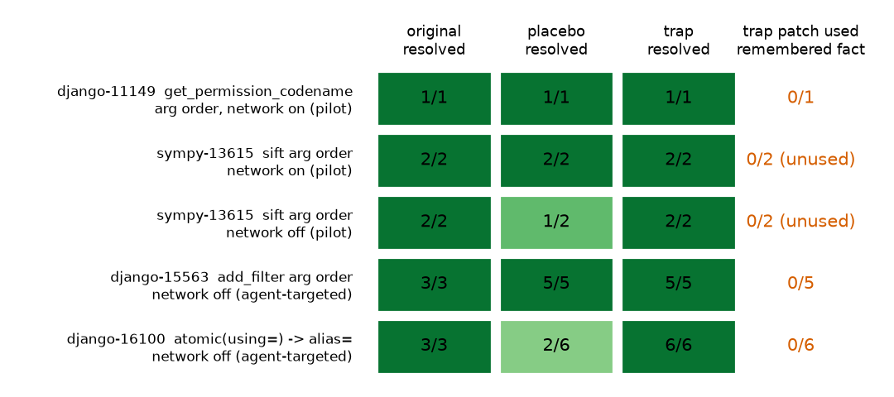

# Read or Remembered?

**Do coding agents reason from the repository they are given, or from code they memorized in training?**

This repo holds the code, derived data, trap catalog and model for a study of where coding agents' factual claims
come from. When an agent says "`get_permission_codename` takes `(action, opts)`" or "the go-redis option is
`IdleTimeout` with a 5-minute default", did it read that during the run, or recall it from training data, possibly
from a different version of the code? If agents lean on memory, benchmark scores on public repositories partly
measure memorization, not coding ability.

Status: research code (November 2026), written for an ICML 2027 submission. The study design was shaped by feedback
from You Wang (Zhejiang University), whose study of faulty claims in coding agents (arXiv 2610.32338) and public
artifact this work builds on.

## Questions

| | question | data |
|---|---|---|
| RQ1 | Where do agents' factual errors come from: code they read and misread, or memory (including other versions of the code)? | 76,537 claims from You Wang et al.'s 400 SWE-bench Pro runs; 1,500 SWE-bench Verified runs; 1,704 DeepSWE runs (39 models) |
| RQ2 | If a remembered fact is made false (a *memory trap*, with a same-size placebo edit), do agents follow memory? Where do errors appear, and are they caught? | trap catalog (8 trap types) + agent runs with no network and squashed git history |
| RQ3 | Does the reasoning admit when it relies on memory? | hidden vs visible reasoning in all of the above |
| RQ4 | Can benchmarks be refreshed against memorization while keeping tasks valid? | fact-targeted refresh with a validation rule + RecallAudit, a small open classifier for auditing runs |

## Findings so far

**RQ1, claims (You Wang et al.'s runs; the two DeepSeek models ran with no network and pruned git history).**
- Most faulty claims come *after* the agent was shown at least part of the code behind them. The cited code was
  never shown before the claim for only 8.6% of refuted claims (95% CI 7.7-9.5), vs 6.2% of supported claims. For
  the 257 human-confirmed Misstatement/Misreference claims it is 7.0%. So most explicit factual errors look like
  misreading or partial reading, not pure recall.
- The memory signal is in *names*: refuted claims name identifiers that exist only in other versions of the
  repository about twice as often as supported claims (3.6% vs 1.8%; for claims about the original code 4.0% vs
  1.1%). Checked cases include go-redis v8's `IdleTimeout` (the repo pins v9, where it is `ConnMaxIdleTime`) and names
  that first appear in the task's own upstream fix, used by agents with no network and no git history.
- **Provenance of all 257 claims (LLM-annotated):** propagated from an earlier faulty claim 95 (37.0%),
  read-but-misread 69 (26.8%), unsupported 35 (13.6%), convention guess 33 (12.8%), recalled from another version
  25 (9.7%, 95% CI 6.7-14.0; 7 of them use names from the task's own upstream fix). 59.1% contradict something the
  agent had already been shown. A second, independent LLM annotator agrees on 36 of 44 double-labeled claims
  (Cohen's kappa 0.76); no adjudication. Details: `notes/provenance.md`, `outputs/provenance/summary.json`.
- An LLM annotator agrees with You Wang et al.'s 773 human error-type labels on 80% of claims (Cohen's kappa 0.69;
  88% on Misstatement/Misreference vs the rest). On 600 unlabeled refuted claims from the same runs it finds 61%
  Misstatement/Misreference.

**RQ1, repository facts at scale (deterministic).** On SWE-bench Verified, 24.0% of the repo facts agents state
(paths, symbols, signatures) are stated before any tool output showed them, and 90.5% of those are right. On DeepSWE
(newer repos, 39 models) it is 7.2%, 80.7% right. Wrong ones are mostly names that never existed in any version;
only 23% (Verified) and 39% (DeepSWE) are ever contradicted later in the run, because most sit in reasoning and are
never acted on.

**RQ3, disclosure.** Explicit memory talk ("let me recall the actual fix", "in newer Django versions...") lives in
hidden reasoning: 12.9% of hidden steps vs 1.2% of visible steps in You Wang et al.'s runs (DeepSeek-V4.1-Flash:
37% of hidden steps), 1.35% vs 0.23% on DeepSWE. 84% of wrong claims about names the agent had never seen are stated
plainly, with no hedge.

**Local memorization probes.** Small local models (Qwen2.5 0.5B-7B) prefer the real line over a trapped one, but
almost as much for random functions no agent used, so the preference is mostly general code knowledge. Reported as a
limitation of likelihood probes.

## RQ2: memory traps

A trap changes one remembered fact (argument order, default, name, location, exception, return order, keyword,
flag) consistently across the repo, tests and gold patch; a placebo makes an edit of the same size that keeps the
fact. Rules: the trap must look like a real refactoring, must matter for the task (the verbatim upstream fix fails in
the trap and passes in the placebo), and must not be visible next to the edit. Design: `docs/trap-design.md`.

- **Agent runs (DeepSeek V4 Flash, mini-swe-agent, `--network none`, squashed git history):** 5 traps, 1-20 runs
  per arm. Only 1 of 31 targeted trap runs submitted the remembered fact. Agents copy usage
  from call sites they read. For the very common `transaction.atomic(using=...)` (renamed to `alias=`), memory still
  surfaces: the hidden reasoning noted the conflict in 6/6 trap runs (visible text 4/6), and 1 run hit the
  `TypeError` and fixed it. This matches You Wang's prediction that simple traps show up mid-trajectory, not in the
  final patch.
- **Memory can override visible code:** in trap C the renamed keyword (`alias=`) sat on the exact line the fix edits,
  yet 8 of 40 trap and placebo runs rewrote it back to the remembered `using=`. In the trap, 4 of those 5 runs hit the
  `TypeError` and fixed it; 1 submitted it and failed (trap 19/20 resolved vs placebo 20/20).
- **Network matters more than memory:** with network on, 6 of 9 pilot runs downloaded the upstream fix.
- **Catalog:** 18 trap/placebo pairs of all 8 types in 15 SWE-bench Verified tasks (`traps/catalog/`). **Docker
  validation in the official SWE-bench images: 15 of 18 pairs are valid** (8 checks per pair, `--network none`;
  `outputs/traps/validation.json`, `notes/trap-validation.md`). The 3 invalid pairs, both default-value traps (T2)
  and one rename (T3), fail only one check: the verbatim upstream fix still passes in the trap, so the trapped fact
  does not matter for the task's tests, and the rule rejects them automatically. Valid by effect: loud 8 of 9, quiet
  5 of 7, flag inversions (loud by name, quiet by value) 2 of 2. The django-11149 pilot trap is also valid in Docker.
  Static coverage: 218 of 500 Verified tasks admit at least one trap on a fact the gold patch uses.

## RQ4: RecallAudit (model)

A small open classifier that flags explicit recall of training knowledge in agent reasoning, for auditing benchmark
runs. v0 = TF-IDF + logistic regression, trained on 249 LLM-annotated steps (400 labeled in all, 4 of the 15
sampled batches; no DeepSWE data in training). Held-out tasks (n=71): precision 0.82, recall 0.39, F1 0.53, AUROC
0.91, vs precision 0.69, recall 0.48, F1 0.56 for the recall lexicon (family A). DeepSWE (n=80): precision 0.71,
recall 0.56, AUROC 0.87, and there the lexicon is better (precision 0.75, recall 0.89). So v0 does not replace the
lexicon yet; small sample, wide intervals. **Correction:** v0.1.0 listed the lexicon at precision 0.32; that came from
a scoring bug (the baseline flagged every item), fixed in v0.2.0. The classifier and its numbers are unchanged
(`notes/recall-audit.md`). Weights in the GitHub release (`recall-audit-v0.zip` in v0.2.0, the same weights as
`recall-audit.zip` in v0.1.0), card in `models/recall-audit/MODEL_CARD.md` (inside the zip), inference:
`scripts/recall_audit.py`.

## Repository layout

- `scripts/`: every analysis, one script per step (each file starts with a plain-language docstring and usage line).
- `rr_traps/`: the memory-trap builder (8 trap types, each with a placebo) and `tests/` for it.
- `traps/catalog/`: built traps: diffs for trap, placebo, carried gold/test patches and the verbatim upstream fix.
- `outputs/`: derived results (JSON/CSV) behind every number in the paper.
- `notes/`: write-ups per analysis with exact commands, results tables and caveats (new in v0.2.0:
  `provenance.md`, `trap-validation.md`, `recall-audit.md`).
- `docs/`: trap design rules, figures, reproduction guide.

## Data and licenses

Code: MIT. Raw data is downloaded by the scripts, not redistributed:
- You Wang et al.'s artifact (Zenodo 10.5281/zenodo.23093905, CC-BY-4.0): derived per-claim features and labels here
  are released under CC-BY-4.0 with attribution.
- SWE-bench Verified tasks and the public mini-swe-agent runs from the SWE-bench submissions bucket.
- DeepSWE (Datacurve, deepswe.datacurve.ai): its trajectories have no redistribution license, so only aggregate
  counts appear here; no DeepSWE text is in this repo and none was used for training.

## Reproduce

See `docs/reproduce.md`. All analyses run on a laptop with no paid API calls except the agent runs on traps
(DeepSeek API, a few cents per run, `--network none`).

## Citation

See `CITATION.cff`.
